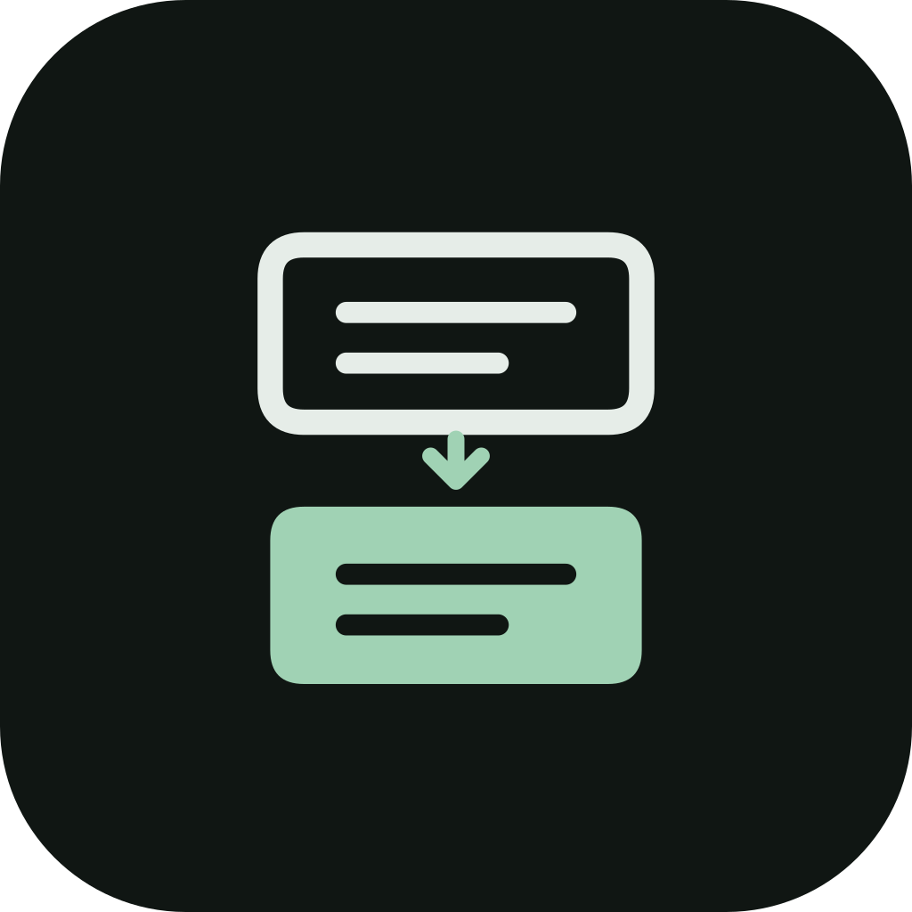

# Thor Auto Translate

Translate game dialogue and instructions from the upper screen of an AYN Thor onto its lower screen. No camera, ROM scanning, game files, or translation packs required.



Thor Auto Translate is an independently maintained application derived from Camera Translator by crosswindfighter. Its Android application ID and source namespace are `com.thorautotranslate`. The original MIT license and attribution are retained; see [NOTICE.md](NOTICE.md).

This application installs alongside earlier `com.example.cameratranslator` builds. It does not import their settings, API keys or downloaded models. Complete setup and enable the new Accessibility service after installation. Disable the old service if it is still enabled to avoid two translators running together.

## Features

- Automatically opens for enabled games/emulators and closes when you leave the game.
- Keeps the last **three complete translations**. New text is larger and brighter below, older passages fade above. Long passages wrap and remain scrollable without line truncation.
- First-run setup for interface language, game/translation languages, translation method, screens, text size and screen-reading consent.
- Interface in English, Turkish, German, Spanish, French, Portuguese, Japanese, Korean and Simplified Chinese. Interface language is independent of the translation language and can be changed later.
- On-device ML Kit translation; Google online without a key; or Google Cloud with your own API key. New installations default to on-device translation.
- Live processing overlaps local translation with OCR confirmation, tracks the dialogue region, periodically checks for text elsewhere, and keeps only the newest pending translation. Pixel processing runs off the UI thread.
- Local OCR for Latin, Japanese, Chinese, Korean and Devanagari scripts. Dialogue/instruction filtering suppresses common counters and menu labels.

## Install

When a release is published, download the signed `thor-auto-translate-1.0.1-release.apk` from this repository’s Releases page and verify it against the accompanying `SHA256SUMS-1.0.1`. Source preparation alone does not publish an APK. Android 11 or later, ARM64, and two displays are required; hardware validation uses AYN Thor with Android 13.

1. Open the app. Setup moves to the lower screen.
2. Choose the interface, game and translation languages.
3. Choose a translation method. On-device translation downloads language models on first use. Google Cloud requires an API key with Translation API access and may incur charges. The keyless online service may be limited or unavailable.
4. Select the screens and reading preferences. Read and accept the screen-reading disclosure, enable the Thor Auto Translate service in Android Accessibility settings, then finish setup. The optional Android accessibility shortcut is not needed.
5. Open a game on the upper screen. Enable an unrecognized emulator in **Apps**. When a selected game starts, the app switches to translation even if its settings were already open. Launching the app during gameplay also returns to translation. Use the small settings button on the panel to edit preferences; those settings stay open for the current game. **Return to translation** brings back the panel. The main switch pauses translation.

Android may require allowing restricted settings for a sideloaded app before enabling Accessibility. An existing developer/debug installation has a different signing key from the public release and cannot be updated in place with the release APK. Keep using the debug build during development, or back up your settings and uninstall it before switching to release. Subsequent public releases must use the same release signing key.

## Privacy

Screen reading runs only after setup and consent, while an enabled app is in the foreground. Images stay in memory and are not written to files. ML Kit translation stays on the device after language model download. Online methods send recognized text to Google; Cloud also uses your key. There is no separate app analytics or advertising integration; Google ML Kit can send SDK diagnostics and usage metrics to Google. Preferences and API keys are excluded from Android backups. See [PRIVACY.md](PRIVACY.md).

## Build

Open this repository root in Android Studio. Use JDK 21 and Android SDK Platform 36. The checked-in Gradle wrapper uses Gradle 9.4.1; do not substitute a system Gradle installation. Set `sdk.dir` in your local `local.properties` (never commit it), or configure `ANDROID_HOME`.

The first build needs internet to download Gradle/Maven dependencies. No translation model or signing credential is needed to build.

```sh
bash ./gradlew :app:assembleDebug :app:testDebugUnitTest :app:lintRelease
bash ./gradlew :app:assembleRelease
```

Without a private signing configuration, the release build is unsigned. [RELEASING.md](RELEASING.md) explains signing and release preparation. Use the same private release key for future `com.thorautotranslate` updates. Older package identities remain separate installations.

Device tests require a two-screen Thor and internet:

```sh
bash ./gradlew :app:assembleDebugAndroidTest
adb install -r app/build/outputs/apk/debug/app-debug.apk
adb install -r app/build/outputs/apk/androidTest/debug/app-debug-androidTest.apk
adb shell am instrument -w -r -e class com.thorautotranslate.OnboardingTest,com.thorautotranslate.TranslationManagerTest,com.thorautotranslate.ScreenTranslationTest com.thorautotranslate.test/androidx.test.runner.AndroidJUnitRunner
```

The real-game OCR calibration test uses an optional private `app/src/androidTest/assets/game-tutorial.png` screenshot. It is excluded from the public source distribution and that one test is skipped when the image is absent. Other fixtures are synthetic and included.

OpenRouter is planned as an optional method with a user-supplied key; it is not included in this build. Experimental Qwen/GGUF models and their native runtime have been removed. Upgrading cleans their app-specific downloads without removing ML Kit language packs or API keys.

## Limits

OCR and dialogue selection use visual/text heuristics, and can miss unusual fonts or fast text transitions. Translation is delayed by screen reading and, for online methods, network latency. Reading only the lower 45% misses instructions elsewhere. Protected screens cannot be read. Android force-stop, revoked access and battery restrictions can stop the service. The overlay covers the lower game image in DS/3DS emulators. Translation uses Google Translate through ML Kit or the chosen online method. Translations are machine-generated; Google provides no warranties of translation accuracy, reliability, merchantability, fitness for a particular purpose or non-infringement. See [Google Translate attribution and disclaimer](https://docs.cloud.google.com/translate/attribution) and [Cloud Translation](https://cloud.google.com/translate).

## License

Derived from Camera Translator. The original MIT copyright and license are preserved in [LICENSE.md](LICENSE.md). Bundled dependencies and language models retain their own licenses/terms. Test fixtures are separate from the user APK. The [upstream security report](docs/history/camera-translator-security-report.md) concerns only the original Camera Translator APK, not Thor Auto Translate. Historical development and verification notes are in `docs/history/`; current verification is in [TESTING.md](TESTING.md).
